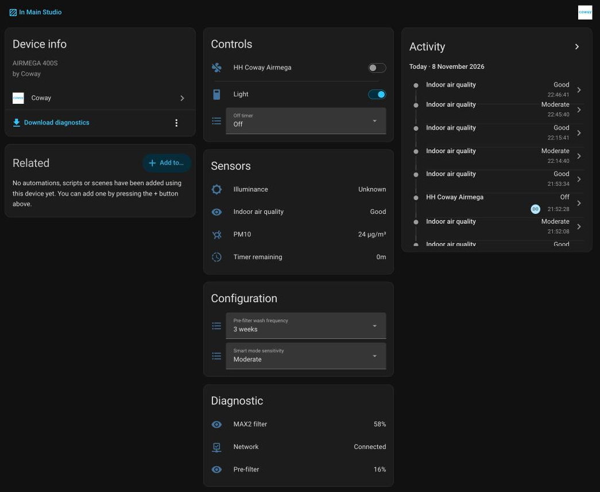
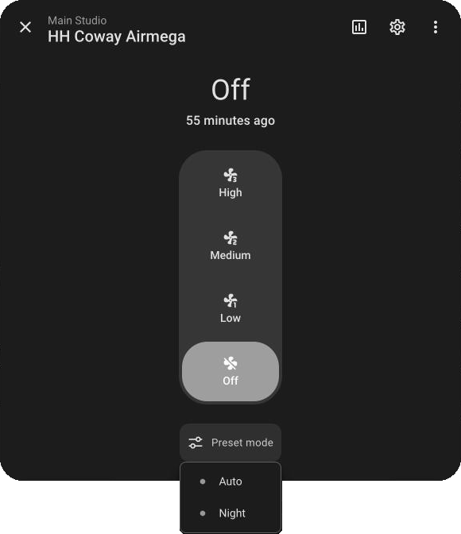
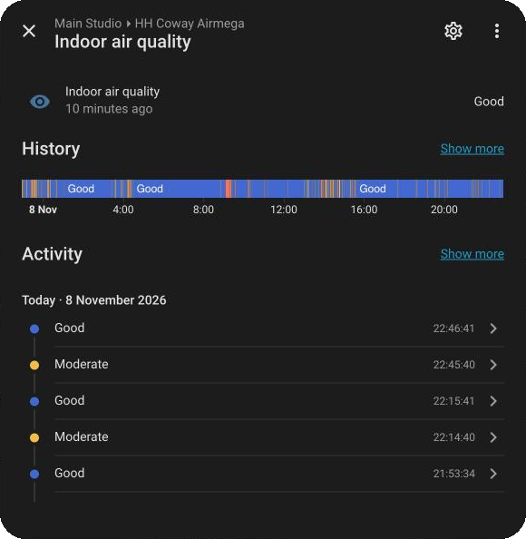
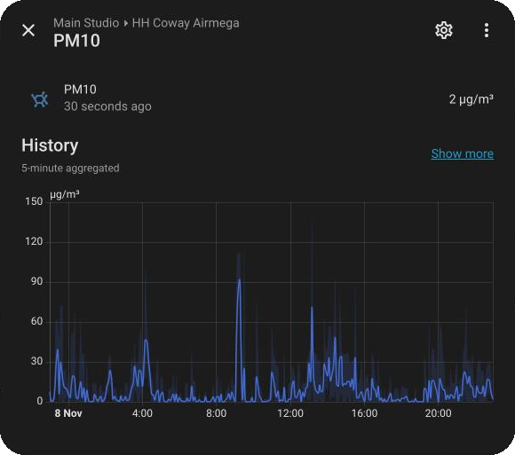
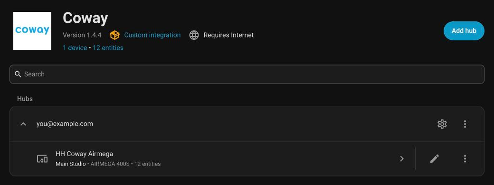
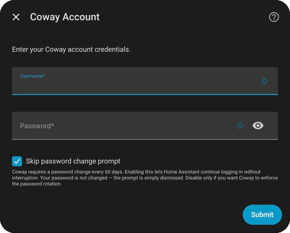
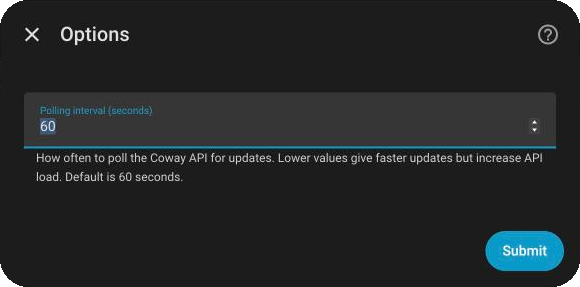

# Coway Integration for Home Assistant

[](https://hacs.xyz/)
[](https://github.com/Antonio112009/ha-coway/releases)
[](https://www.home-assistant.io/)
[](https://github.com/Antonio112009/ha-coway/actions/workflows/ci.yml)
[](LICENSE)

Custom [Home Assistant](https://www.home-assistant.io/) integration for [Coway](https://www.coway.com/) air purifiers connected through the IoCare+ cloud service.

This integration adds your Coway purifiers as Home Assistant devices, with support for fan control, preset modes, filter-life sensors, air-quality metrics, timer controls, and model-specific features such as light modes and button lock.

<p align="center">
  
</p>

> [!IMPORTANT]
> Your purifiers must be registered with the **IoCare+** app before they can be used with this integration.

## Highlights

- Native Home Assistant config flow
- HACS support
- Multiple purifiers supported under one Coway account
- Configurable cloud polling interval from 30 to 600 seconds
- Model-aware entities so unsupported controls are not created

## Screenshots

<table>
  <tr>
    <td align="center" valign="top" width="50%">
      <br>
      <sub><b>Fan control</b>: three speeds plus the model's preset modes</sub>
    </td>
    <td align="center" valign="top" width="50%">
      <br>
      <sub><b>Indoor air quality</b>: the purifier's own Good / Moderate / Unhealthy grade, with history</sub>
    </td>
  </tr>
  <tr>
    <td align="center" valign="top" width="50%">
      <br>
      <sub><b>Particulate sensors</b>: PM10 (and PM2.5 where the model has it) with long-term statistics</sub>
    </td>
    <td align="center" valign="top" width="50%">
      <br>
      <sub><b>One hub per Coway account</b>: every purifier on the account is added as its own device</sub>
    </td>
  </tr>
</table>

## Requirements

- Home Assistant 2026.8 or newer
- A Coway account that can sign in to the IoCare+ app
- At least one purifier already registered in IoCare+
- Home Assistant with access to HACS for the recommended install method

> [!NOTE]
> This is a cloud-polling integration. Commands are sent immediately, then the integration refreshes device state from Coway shortly after.

## Installation

### HACS (recommended)

[](https://my.home-assistant.io/redirect/hacs_repository/?owner=Antonio112009&repository=ha-coway&category=integration)

> [!TIP]
> If the button above doesn't work, manually add this repository as a custom repository in HACS:
> 1. Open HACS in Home Assistant.
> 2. Click the three dots in the top right, then choose **Custom repositories**.
> 3. Add `https://github.com/Antonio112009/ha-coway` with category **Integration**.
> 4. Install **Coway** from HACS.
> 5. Restart Home Assistant.

### Manual

1. Download and copy `custom_components/ha_coway` into your Home Assistant `config/custom_components/` directory.
2. Restart Home Assistant.

> [!WARNING]
> Manual installations don't receive update notifications. You can watch this repository or subscribe to [releases](https://github.com/Antonio112009/ha-coway/releases) to stay informed.

## Setup

[](https://my.home-assistant.io/redirect/config_flow_start/?domain=ha_coway)

Or manually: go to **Settings** > **Devices & Services** > **Add Integration** and search for **Coway**.

During setup, you will be asked for:

- Your Coway username
- Your Coway password
- Whether to enable **Skip password change prompt** (enabled by default)

<p align="center">
  
</p>

> [!CAUTION]
> Coway may prompt you to change your password if it hasn't been updated in a while. During setup, you can select **Skip password change** to bypass this. If you don't skip, you'll need to update your password in the IoCare+ app first, then re-authenticate the integration in Home Assistant.

After setup, you can adjust the polling interval from **Settings** > **Devices & Services** > **Coway** > **Configure**. The default is `60` seconds, and the allowed range is `30` to `600` seconds.

<p align="center">
  
</p>

To change the password, the username, or the password-change setting later, use **Reconfigure** from the integration menu. Purifiers added to your Coway account later appear on the next poll without a reload, and a purifier that is no longer in your account can be deleted from its device page.

## Entities

Each purifier is exposed as a device in Home Assistant. The exact entity set depends on the model and on which values the Coway API reports for that device.

| Category | Entities |
|----------|----------|
| `Fan` | The purifier itself, named after the device, with power, speed control, and preset modes |
| `Select` | `Off timer`, `Smart mode sensitivity`, `Pre-filter wash frequency`, `Light mode` |
| `Switch` | `Light`, `Button lock` |
| `Sensor` | `Indoor air quality`, `Air quality index`, `PM2.5`, `PM10`, `CO2`, `VOC`, `Illuminance`, filter-life sensors, `Timer remaining` |
| `Binary sensor` | `Network` |

### Supported models

The integration detects the model family and only creates the controls that model actually has.

| Model | Preset modes | Light control | Button lock | Filter-life sensors |
|-------|--------------|---------------|:-----------:|---------------------|
| Airmega 400S | `Auto`, `Night`, `Auto (Eco)`¹ | `Light` switch | — | `Pre-filter`, `MAX2 filter` |
| Airmega IconS | `Auto`, `Night`, `Auto (Eco)`¹ | `Light mode` select: On, Off, AQI off, Half off | — | `Pre-filter`, `MAX2 filter` |
| Airmega 250S | `Auto`, `Night`, `Rapid`, `Auto (Eco)`¹ | `Light mode` select: On, Off, AQI off | ✅ | `Pre-filter`, `MAX2 filter` |
| AP-1512HHS | `Auto`, `Eco` | `Light` switch | — | `Pre-filter`, `MAX2 filter` |
| AP-1512HHS UK/EU | `Auto`, `Eco` | `Light` switch | — | `Charcoal filter`, `HEPA filter`² |
| Other models (default behavior) | `Auto`, `Night`, `Auto (Eco)`¹ | `Light` switch | — | `Pre-filter`, `MAX2 filter` |

¹ `Auto (Eco)` is listed only while the purifier reports that it is running in eco auto mode.<br>
² UK/EU variants of the AP-1512HHS also have no `Pre-filter wash frequency` select.

`PM2.5` is not created for models that report the generic `AIRMEGA` product name, because they have no dedicated PM2.5 sensor; `PM10` is still available.

> [!NOTE]
> Only supported entities are created. If the Coway API does not provide a value for a given sensor or control, that entity is omitted automatically.

### Example dashboard card

A ready-made card for a purifier: power, speed and preset modes on one tile, with air quality and filter life underneath. Paste it into a dashboard with **Edit dashboard** > **Add card** > **Manual**.

Entity IDs are based on the purifier's name, so replace `living_room_purifier` with yours (for example, a purifier named *Bedroom Airmega* becomes `fan.bedroom_airmega`). The exact IDs are listed on the purifier's device page under **Settings** > **Devices & Services**. If your model has different preset modes or filter sensors, adjust them using the [Supported models](#supported-models) table.

```yaml
type: vertical-stack
cards:
  - type: tile
    entity: fan.living_room_purifier
    features:
      - type: fan-preset-modes
        style: icons
        preset_modes:
          - auto
          - night
      - type: fan-speed
  - type: grid
    columns: 2
    square: false
    cards:
      - type: tile
        entity: sensor.living_room_purifier_indoor_air_quality
      - type: tile
        entity: sensor.living_room_purifier_pm10
      - type: tile
        entity: sensor.living_room_purifier_pre_filter
      - type: tile
        entity: sensor.living_room_purifier_max2_filter
```

## Troubleshooting

### Authentication fails

- Confirm the same username and password work in the IoCare+ app.
- If Coway is forcing a password rotation, enable **Skip password change prompt** during setup or update the password in the app first.
- If authentication stops working later, remove and re-add the integration.

### Some entities are missing

- This is usually model-specific behavior rather than an error.
- A purifier newly added to your Coway account appears on the next poll. If it does not, reload the integration.
- Check whether the missing control is one of the model-specific differences listed above.

### Updates feel slow

- Lower the polling interval in the integration options.
- Keep in mind that lower intervals create more API traffic to Coway.

## Support

If you find a bug or a device-specific incompatibility, open an issue on [GitHub](https://github.com/Antonio112009/ha-coway/issues).

If possible, attach Home Assistant diagnostics for the Coway integration with the report. This integration supports diagnostics export, and sensitive fields such as your username, password, and device identifiers are redacted automatically.

To download diagnostics in Home Assistant, open `Settings > Devices & Services > Coway`, then use the integration menu to download diagnostics before filing the issue.

You do not need to enable anything extra in Home Assistant to make diagnostics available. The Diagnostics integration is built in and enabled by default.

## License

This project is licensed under the MIT License. See `LICENSE`.

## Acknowledgements

This integration was developed independently from scratch, but was inspired by the work of **Dr. Drinovac** ([@RobertD502](https://github.com/RobertD502)) and his [IoCare Home Assistant integration](https://github.com/RobertD502/home-assistant-iocare). While both integrations share the same idea of bringing Coway purifiers to Home Assistant, they are built on different libraries — this one uses [pycoway](https://github.com/Antonio112009/pycoway), while the original uses [cowayaio](https://github.com/RobertD502/cowayaio).

Robert collects donations for a local animal rescue. If you'd like to support his work:

<a href="https://www.buymeacoffee.com/RobertD502" target="_blank"></a>
<a href="https://liberapay.com/RobertD502/donate"></a>
